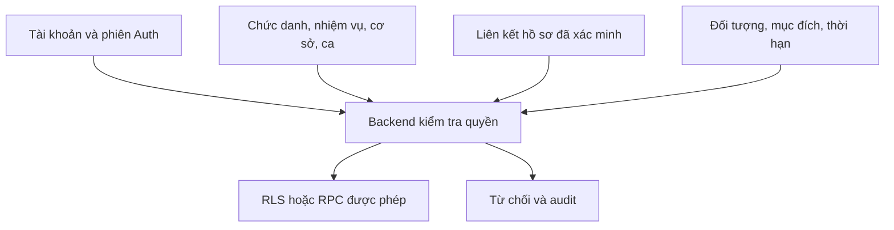

# MediQueue — đề xuất RBAC + ABAC

Ngày rà soát: 25/10/2026 (Việt Nam). Repo gốc `f6381a3faa24c166f9d86b27cc803b1362057f2c`. Project duy nhất: `buolfdpdfnbmruecrtum` (MediQueue-Dev).

**Trạng thái: PARTIAL, đề xuất và kiểm thử cục bộ. Không áp dụng migration lên Dev, không merge/deploy Pages, không sửa UI/UX V4 hoặc FloodGuard.**

## 1. Kết quả kiểm kê hiện trạng

Đã đọc trực tiếp catalog PostgreSQL, RLS, chữ ký/nội dung hàm, trigger, grant, index và 10 migration đang áp dụng. GitHub hiện chỉ lưu 2 migration V3; 8 migration cũ có trong lịch sử Dev nhưng chưa được lưu thành SQL canonical trong repo. `security/rbac-abac/tests/baseline-schema.sql` là fixture schema-only lấy từ catalog, **không phải bản thay thế lịch sử migration và không được chạy vào cloud**. Auth/users/sessions của fixture được mô phỏng tối thiểu; không xuất dữ liệu bệnh nhân, tên người dùng, email hay token.

- `mq_profiles.id -> auth.users.id`, role patient/staff/admin, chỉ đọc profile chính mình.
- `mq_tickets.patient_id -> auth.users.id`: danh tính người đăng nhập đang kiêm chủ phiếu. `patient_name` do người đăng ký nhập, không phải hồ sơ được xác minh. Không có bệnh án lâm sàng trong schema này.
- `mq_staff_assignments`: 8 chức danh, khoa/phòng, valid_from/to, active, granted_by; có trigger yêu cầu staff xác minh email và phòng đúng khoa.
- `can_task` kiểm tra trực tiếp assignment hiện hành, không tin role từ localStorage/user_metadata. Các RPC hàng chờ gọi require_task; RLS phiếu kiểm tra chính chủ patient hoặc assignment read.
- `department_lead` là chức danh staff, không phải Hospital Super Admin. Tuy nhiên quyền hiện tại khá rộng: trưởng khoa có thể gọi/START/FINISH theo role ceiling.
- Super Admin: private grant + profile admin + email xác minh + AAL2; endpoint overview chỉ tổng hợp, không patient_name. Chưa có CRUD quản trị toàn viện; không tuyên bố đã có.
- Khoảng trống: chưa có cơ sở, nhiệm vụ riêng, hồ sơ bệnh nhân và quan hệ đại diện; staff thông thường chưa bắt buộc AAL2/live-session; overview admin chưa kiểm tra session tồn tại/thời hạn grant; audit chủ yếu là hành động hàng chờ và thay đổi assignment, chưa phải mọi lần đọc/từ chối.
- **Lỗi tái hiện cục bộ:** staff từng là patient vẫn gọi được `mq_my_wait_info` và `mq_cancel_my_ticket` với phiếu cũ của tài khoản, dù SELECT RLS đã chặn. Hai SECURITY DEFINER này chỉ kiểm tra ownership. Migration owner_rpc_role_guard bổ sung check patient, giữ chữ ký và nghiệp vụ còn lại. Không khai thác trên dữ liệu cloud.

## 2. Tham khảo quy trình công khai, không suy đoán nội bộ

| Nguồn công khai | Điều quan sát được | Quyết định thiết kế của MediQueue |
|---|---|---|
| MyVinmec: quản lý sức khỏe cá nhân/gia đình; hướng dẫn kết nối hồ sơ và khai báo trước khám | Có hồ sơ người thân, kết nối hồ sơ, lịch hẹn và QR tiếp đón | Tách login khỏi patient record; QR là token nghiệp vụ, không phải quyền xem bệnh án |
| Quy định ứng dụng BVĐK Tâm Anh, mục 4–6 | PID được liên kết sau đối chiếu; OTP gửi đến số đã đăng ký của bản thân/người thân; chia sẻ có thời hạn; xóa login không đồng nghĩa xóa bệnh án | Link phải xác minh; không chấp nhận chỉ biết PID/họ tên/ngày sinh; tách vòng đời tài khoản, hồ sơ và consent |
| Hồng Ngọc: hướng dẫn đặt lịch qua hotline/web/Smedic365 | Chọn dịch vụ, bác sĩ/khung giờ/chi nhánh; nhân viên xác nhận lịch | Booking, tiếp đón và điều trị là các nhiệm vụ riêng có cơ sở/phòng/ca, không suy diễn đặt lịch là đã check-in |

Nguồn (đã mở kiểm tra 25/10/2026):
- https://www.vinmec.com/vie/bai-viet/my-vinmec-ung-dung-dien-thoai-giup-quan-ly-tron-ven-suc-khoe-ca-nhan-va-gia-dinh-vi
- https://www.vinmec.com/vie/bai-viet/huong-dan-khai-bao-truoc-kham-tai-ung-dung-myvinmec-vi
- https://tamanhhospital.vn/chinh-sach/quy-dinh-su-dung-ung-dung-di-dong/
- https://hongngochospital.vn/vi/huong-dan-dat-lich-kham-tai-bvdk-hong-ngoc

Đây là suy luận thiết kế độc lập từ hành trình công khai; không phải mô tả database, RBAC hoặc hệ thống nội bộ của ba bệnh viện. Quy trình OTP tham khảo không thay thế thẩm định tư cách đại diện hợp pháp của MediQueue.

## 3. Mô hình mục tiêu và nguyên tắc cấp quyền

Quyết định cho phép = tài khoản đang xác minh/phiên còn hiệu lực AND role cho phép loại nhiệm vụ AND nhiệm vụ được cấp riêng AND phạm vi cơ sở/khoa/phòng phù hợp AND ca hiện hành AND điều kiện đối tượng/mục đích phù hợp. Thiếu thuộc tính hoặc không có quyền: từ chối.

Không cấp quyền từ URL/menu/chọn role/client claims tự sửa. Claim AAL phải đến từ JWT đã được Auth gateway xác thực; SQL fixture giả lập claim **không chứng minh MFA thực**. Quyền và hiệu lực đọc từ DB ở mỗi statement, không cache grant trong JWT. Thu hồi/hết ca áp dụng từ truy vấn kế tiếp, không thể thu hồi dữ liệu đã tải xuống. Giao dịch đang chạy dùng snapshot: thao tác nhạy cảm tương lai phải kiểm tra lại sau khi lấy khóa và ngay trước ghi; không hứa hủy ngược giao dịch đã commit.

### Login và patient record

- Account là principal đăng nhập; patient record tồn tại độc lập, không FK cascade đến auth.users. Một account có nhiều link, một patient có thể có nhiều đại diện được xác minh.
- Link gồm relationship, scopes, state, valid_from/to, revoked_at, verified_by, verified_at, evidence_ref opaque. Email xác minh chỉ chứng minh kênh đăng nhập, không chứng minh quyền sở hữu hồ sơ.
- Luồng mục tiêu: yêu cầu liên kết -> backend giới hạn tần suất, phản hồi chống dò PID -> OTP/challenge tới kênh đã có tại bệnh viện hoặc xác minh trực tiếp -> kiểm tra quyền đại diện/ủy quyền -> reviewer độc lập xác nhận -> link verified giới hạn thời gian/phạm vi. Người yêu cầu không tự duyệt. Trẻ em/người được giám hộ cần quy trình xác minh giấy tờ/quan hệ và rà soát thời hạn; OTP không đủ chứng minh giám hộ.
- Không lưu CCCD/ảnh chứng từ/token OTP trong bảng link/audit. Evidence UUID trỏ tới kho riêng với retention và quyền riêng. Không đưa tài liệu chứng minh vào repo hay frontend.
- Foundation chỉ có cấu trúc link và API đọc link hợp lệ. **Chưa có endpoint yêu cầu/duyệt, nhà cung cấp OTP, kho chứng từ hoặc workflow reviewer**; không tạo quyền bằng việc nhập PID.
- `mq_tickets.patient_id` được giữ nguyên để không hỏng API cũ. Thêm nullable `patient_record_id`, không backfill theo account/name. Việc chuyển lấy số/hủy/xem phiếu qua đại diện là giai đoạn sau, chỉ mở khi RLS và các RPC cùng kiểm tra link. Foundation chưa cấp quyền đọc phiếu qua link.
- Xóa login không xóa patient record. Link đang FK mq_profiles dùng NO ACTION để không xóa mất dấu vết một cách ngầm định; quy trình offboarding cần vô hiệu hóa/revoke và xử lý lưu trữ có kiểm soát trước khi xóa account. Chưa triển khai xóa account tự phục vụ.

### Nhân viên, trưởng khoa, quản trị

- Giữ 8 job_title hiện có. Bổ sung facility mapping của khoa và assignment_tasks; quyền thực là giao của role ceiling và nhiệm vụ được cấp, không phải union tùy tiện.
- Mỗi dashboard phải truyền assignment_id; backend kiểm tra assignment thuộc actor, không mượn quyền từ assignment khác. Một bác sĩ có hai ca/chức danh chỉ chuyển giữa context server trả về.
- Department code hiện global unique. Foundation ánh xạ mỗi khoa tới một cơ sở, không âm thầm nhân bản/migrate khoa. Nếu cần cùng mã khoa ở nhiều cơ sở, dùng department UUID/campus mapping trong migration sau; không đổi khóa code đang được RPC dùng.
- Trưởng khoa được cấp nhiệm vụ điều phối/audit khoa, không tự được grant toàn viện. Theo nguyên tắc tối thiểu, không seed call/START/FINISH cho trưởng khoa; muốn khám cần assignment doctor riêng. Foundation role ceiling còn tương thích V3 nhưng task grant có thể thu hẹp.
- Super Admin là control plane: cấu hình cơ sở, danh mục, phân công và số liệu vận hành đã giảm định danh. **Không là superuser PostgreSQL**, không BYPASSRLS, không service_role ở trình duyệt, không quyền clinical.read mặc định.
- Quyền đọc bệnh án tương lai cần clinical role + care-team/encounter relationship + cơ sở + mục đích sử dụng và consent/căn cứ xử lý tương ứng. Chưa có bảng bệnh án/care-team nên hiện mặc định từ chối clinical.*; không giả lập khả năng đọc bệnh án bằng hàng chờ.
- Cấp quyền nhạy cảm cần người đề nghị/người duyệt khác nhau, thời hạn, lý do và re-auth; Super Admin không tự duyệt bản thân hoặc cấp clinical access chỉ vì có quyền cấu hình. Chưa triển khai API grant; trusted provisioning là ranh giới quản trị phải được phê duyệt riêng.

## 4. Ranh giới backend và xác thực tăng cường

- RLS trên bảng public, private tables thu hồi quyền trực tiếp. SECURITY DEFINER chỉ cho hàm private nhỏ, search_path rỗng, fully-qualified relations; wrapper public SECURITY INVOKER với EXECUTE authenticated. Không thay grant bằng allow-all.
- Foundation v2 kiểm tra email, is_anonymous=false, session_id thuộc UID và còn tồn tại, not_after chưa hết, AAL2 cho staff. Hệ thống Auth vẫn chịu trách nhiệm exp/signature/revocation gateway. Không coi session row là bằng chứng re-auth gần đây.
- MFA mục tiêu bắt buộc TOTP/SSO policy cho tài khoản nội bộ nhạy cảm, admin, người duyệt link/grant; step-up mới cho cấp quyền, xuất dữ liệu, đổi kênh xác minh. Cần thêm re-auth freshness 5–10 phút do backend xác nhận, không dùng JWT iat (refresh có thể đổi iat) làm thời điểm xác minh MFA.
- Enrollment/challenge/recovery phải có kiểm soát, audit và owner hỗ trợ; hiện UI MFA/recovery/SSO chưa triển khai. Không tắt email confirmation hoặc bypass xác minh để tạo test admin.
- Token hết ca vẫn đăng nhập được nhưng nghiệp vụ phải bị từ chối. Realtime không phải quyền mới: tải lại dữ liệu qua API/RLS, xóa dữ liệu khi context hết hiệu lực; kiểm thử realtime revoke còn BLOCKED.
- Query RLS không tự tạo audit đọc từng dòng. Mọi truy cập nhạy cảm nên qua RPC/BFF được audit; thu hồi SELECT trực tiếp ở giai đoạn clinical, sau khi đổi client. Không dùng side effect trong RLS predicate.

### Audit có giới hạn rõ ràng

New dashboard/profile RPC ghi access_decisions (allow/deny, actor, operation, resource UUID, request_id, timestamp), không tên bệnh nhân, JWT hay chứng từ. Link insert/update có identity_link_audit. Trả JSON lỗi để transaction commit audit cho lời gọi đã được authenticated gateway chấp nhận; client phải kiểm tra ok.

RAISE trong RPC cũ rollback audit cùng giao dịch; anon bị chặn tại EXECUTE không chạy hàm. Cần gateway/access logs cho 401/403, denied legacy RPC và tamper-evident sink ngoài giao dịch; hiện chưa có. Nếu transaction bên ngoài rollback thì audit DB cũng rollback. Foundation có policy_change_audit cho insert/update/delete facility, department mapping và task grant; không ghi payload quyền hoặc PHI. Cần sink bất biến và kiểm thử bền vững log trước cutover. Không tuyên bố audit toàn diện đã đạt.

## 5. Triển khai theo giai đoạn và rollback

1. Review PR/migration/ma trận. Lưu schema baseline, đối chiếu đủ 10 migration. Không tự chạy db reset hoặc migration replay trên Dev.
2. Sau phê duyệt, áp dụng foundation trong transaction; không seed cơ sở/grant từ suy đoán. Chạy advisors và schema/API regression trên Supabase thật. Migration owner-role guard là bản sửa độc lập cần review tác động người dùng có lịch sử đổi vai trò.
3. Xây provisioning, xác minh link/MFA, cấp test identities hợp lệ và cấu hình cơ sở/ca/task theo thực tế. Không tự động biến mọi staff thành doctor hoặc admin.
4. Adapter lấy số v2 cần patient_record_id + idempotency theo account/record/request_key, tên lấy từ hồ sơ đã xác minh; liên kết phiếu cũ do reviewer xác nhận. Đồng thời đổi RLS/cancel/wait/booking/push: khi record_id có giá trị phải kiểm tra link hiện hành, không OR legacy account-owner để bypass revoke. Push chỉ đến principal còn quyền tại thời điểm gửi.
5. Guard RPC hàng chờ cũ bằng v2 scope/session/task sau khi đủ provisioning; kiểm tra lại sau khóa; kiểm thử đối kháng mọi endpoint và Realtime. Tới lúc đó **can_task cũ vẫn hoạt động như trước**, không được mô tả foundation như enforcement toàn hệ thống.
6. Dashboard UI/API v2 và MFA UI chỉ làm khi phạm vi được duyệt, không sửa V4 trong PR này. Chạy E2E hai phiên/2 phòng, MFA thực, offboarding, concurrent revoke trước deploy.

Rollback foundation chưa có dữ liệu: ưu tiên tắt client/API mới, revoke EXECUTE v2, giữ bảng/cột để không mất dữ liệu; không DROP bảng hoặc migration cũ. Nếu đã có link/phiếu record thì cần migration tiến tiếp, không tự xóa record_id. Owner guard chỉ rollback bằng bản hàm trước đã lưu sau review; rollback mở lại lỗ hổng nên ưu tiên sửa tiến tiếp. Không đưa migration rollback phá dữ liệu vào bộ tự chạy.

## 6. Tài liệu kỹ thuật chính thức

- RLS/grants và SECURITY DEFINER: https://supabase.com/docs/guides/database/postgres/row-level-security
- MFA/AAL: https://supabase.com/docs/guides/auth/auth-mfa
- Session lifetime: https://supabase.com/docs/guides/auth/sessions
- Đã xem changelog 25/10/2026: thay đổi TLS CBC dự kiến 10/11/2026 ảnh hưởng client HTTPS cũ, không thay đổi logic RBAC SQL: https://supabase.com/changelog/cbc-tls-ciphers-deprecated
